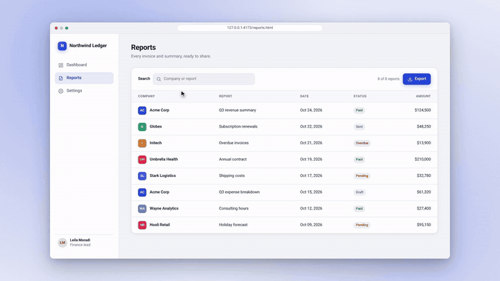

# Demo Director

A Claude Code plugin that turns a web app URL into a polished, silent presentation video, with
camera zooms, a smooth cursor, callouts, chapter cards and English and Persian subtitle files.



## What it does

1. **Ask**: desktop or mobile, URL, login, subtitle languages, target length.
2. **Discover**: Claude opens the app with Playwright and lists routes, features and stable selectors.
3. **Scenario**: writes `.demo/scenario.yaml`, shows it as a table, and waits for your approval.
4. **Rehearse**: a dry run checks every selector without filming.
5. **Record**: a clean Playwright take (no effects) → `raw.mp4` + `events.json`.
6. **Direct**: events become camera moves (max 2.2× zoom on desktop, 1.5× on mobile, eased), cursor arcs and click ripples; idle time is cut.
7. **Compose**: a HyperFrames composition with the take, camera, cursor, callouts and chapter cards; subtitles from beat times.
8. **Render**: storyboard for review, then a silent MP4 via HyperFrames.

## Requirements

- Node.js 22+, FFmpeg (`ffmpeg` and `ffprobe`)
- Chromium via Playwright (installed by the doctor)
- Fonts: Vazirmatn and Noto Color Emoji (otherwise Persian text and emoji render as boxes)
- Linux or macOS. Runs headless, so a VPS without a screen is fine.

## Install

```bash
claude plugin marketplace add amircodington/Video-Presentation-Webapp-Claude-Plugin
claude plugin install demo-director@demo-director
```

Then, inside Claude Code, install the dependencies and check the system:

```
/demo-director:doctor
```

On Debian/Ubuntu the doctor's fix for missing tools is
`sudo apt-get install -y ffmpeg fonts-vazirmatn fonts-noto-color-emoji` (Node 22 via
[NodeSource](https://github.com/nodesource/distributions)).

Optional, the HyperFrames Claude plugin (handy for hand-editing compositions):

```bash
claude plugin marketplace add heygen-com/hyperframes
claude plugin install hyperframes@hyperframes
```

## Commands after install

| Command | What it does |
|---|---|
| `/demo-director:new <url>` | Full interactive run: ask → discover → scenario → approve → rehearse → record → storyboard → render |
| `/demo-director:scenario [change]` | Write or edit `.demo/scenario.yaml` |
| `/demo-director:record [--dry-run]` | Rehearse, then record a new take |
| `/demo-director:render [--draft]` | Compose, storyboard and render from the last take (no re-take) |
| `/demo-director:doctor` | Check Node, FFmpeg, fonts, Chromium; install npm deps |

The same pipeline from a shell (run in your project; `DD` is the plugin's `scripts/demo.mjs`):

```bash
node $DD record --dry-run      # check selectors only
node $DD record                # .demo/raw.mp4 + .demo/events.json
node $DD compose               # .demo/direct.json, .demo/comp/, subtitles
node $DD storyboard            # .demo/out/storyboard.png
node $DD render [--draft]      # .demo/out/demo.mp4
node $DD all [--draft]         # record → compose → storyboard → render
node $DD serve <dir> [--port N]
# common flags: --dir .demo  --scenario <dir>/scenario.yaml  --format desktop|mobile  --url URL
```

## Scenario file

`.demo/scenario.yaml` is the single source of truth (full example:
[`templates/scenario.example.yaml`](templates/scenario.example.yaml)).

```yaml
video:
  format: desktop              # desktop | mobile
  url: http://localhost:4173   # base URL for `path`
  subtitles: [en, fa]
  style: { background: soft-gradient, accent: "#2747D9" }
setup:                         # optional, not filmed (e.g. login)
  - { do: goto, path: /login }
  - { do: type, target: label=Email, text: $ENV{DEMO_EMAIL} }   # secret read from env, never saved
scenes:
  - id: reports
    title: Reports in seconds  # chapter card
    beats:
      - do: type
        target: label=Search
        text: Acme
        say: { en: Find any report by typing., fa: هر گزارشی را با تایپ کردن پیدا کنید. }
      - do: click
        target: role=button[name="Export"]
        camera: focus
        callout: One-click export
        hold: 1.5
```

| Field | Meaning |
|---|---|
| `video.format` | `desktop` or `mobile` (or `--format`) |
| `video.url` | Base URL (or `--url`) |
| `video.auth` | Optional Playwright storage state, e.g. `.demo/auth.json` |
| `video.subtitles` | Languages; one `.srt` + `.vtt` each (default `[en, fa]`) |
| `video.title`, `video.style.accent` | Composition title; callout/highlight colour |
| `setup[]` | Beats run before filming |
| `scenes[].id`, `.title` | Unique id; chapter card text |
| `beats[].do` | `goto` (`path`/`url`), `click`, `hover`, `type` (`text`), `press` (`key`), `scroll` (`target` or `amount`), `wait` (`seconds`) |
| `beats[].target` | Playwright selector: `role=…`, `label=…`, `text=…`, CSS |
| `beats[].camera` | `wide` or `focus` (default `focus` with a target) |
| `beats[].callout` | Short label next to the target |
| `beats[].hold` | Seconds to stay after the action (default 1.0) |
| `beats[].say` | Subtitle line per language, e.g. `{en: …, fa: …}` |

## Outputs

All in `.demo/` (add it to `.gitignore`):

| File | |
|---|---|
| `out/demo.mp4` | Final video, **no audio track** |
| `out/demo.<lang>.srt`, `out/demo.<lang>.vtt` | Subtitles per language (Persian is RTL-marked) |
| `out/storyboard.png` | One frame per scene |
| `raw.mp4`, `events.json` | The clean take and its event log |
| `direct.json`, `comp/` | Camera/cursor keyframes and the HyperFrames composition |

## Desktop vs mobile

| | Desktop | Mobile |
|---|---|---|
| Output | 1920×1080 (16:9) | 1080×1920 (9:16) |
| Look | App inside a browser window on a soft gradient | Full screen |
| Capture | 1440×810 viewport at device scale 2 | 390×693 at density 3, touch, iPhone UA |
| Cursor | Arrow with click ripple | Touch dot |

## Try it on the sample app

```bash
cd /path/to/this/plugin && npm ci && npx playwright install chromium
node scripts/demo.mjs serve examples/sample-app --port 4173 &
node scripts/demo.mjs all --scenario examples/sample-app/scenario.yaml \
  --url http://localhost:4173 --dir .demo-desktop
node scripts/demo.mjs all --scenario examples/sample-app/scenario.yaml \
  --url http://localhost:4173 --dir .demo-mobile --format mobile
```

## Troubleshooting

| Problem | Fix |
|---|---|
| Persian text or emoji show as boxes | `sudo apt-get install -y fonts-vazirmatn fonts-noto-color-emoji && fc-cache -f` |
| Chromium fails to start (missing libraries) | `sudo npx playwright install --with-deps chromium` in the plugin dir |
| `selector not found` / timeout on a beat | `record --dry-run` lists every failing target; switch to `role=…` or `label=…` |
| Zoom looks blurry | Zoom is capped at 2.2× (1.5× on mobile) of a dpr-2 (mobile dpr-3) take; focus on a larger target or use `camera: wide` |
| Render is slow | `render --draft` (or `all --draft`) for previews |
| The MP4 has no sound | By design: the video is silent; subtitles are separate files |
| HyperFrames can't find Chrome | `node node_modules/hyperframes/bin/hyperframes.mjs browser ensure` in the plugin dir (or run the doctor) |

## Development

```bash
npm ci
npm test            # unit tests (scenario, direct, subtitles, compose…)
npm run test:e2e    # sample app → record → render, desktop and mobile
```

```
.claude-plugin/   plugin.json, marketplace.json
commands/         new, scenario, record, render, doctor
skills/           demo-director, scenario-writer, camera-director
scripts/demo.mjs  CLI; scripts/lib/ holds the pure modules; scripts/doctor.sh
templates/        scenario.example.yaml
examples/         sample-app (static demo app + scenario)
test/             unit/ and e2e/
```

## License

MIT
